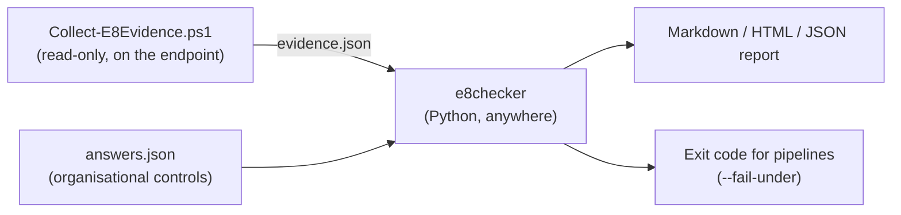

# e8checker

[](https://github.com/hrk18/e8-checker/actions/workflows/ci.yml)


**Assess a Windows endpoint against the ASD Essential Eight (Maturity Level One), and see every
finding mapped to NIST CSF 2.0 and ISO/IEC 27001:2022.**

The [Essential Eight](https://www.cyber.gov.au/business-government/asds-cyber-security-frameworks/essential-eight)
is the Australian Signals Directorate's baseline of eight mitigation strategies, and the standard
most Australian councils and government agencies report against. Checking it by hand means
clicking through Group Policy, registry keys and services on every machine. e8checker collects
that evidence in one read-only pass and turns it into a prioritised, framework-mapped report.

```
Result: 0 of 8 strategies meet Maturity Level One.

| Strategy                           | Verdict             | Pass | Fail | Manual |
| Application control                | Maturity Level Zero | 0    | 2    | 0      |
| Configure Microsoft Office macros  | Maturity Level Zero | 0    | 4    | 0      |
| Restrict administrative privileges | Maturity Level Zero | 0    | 2    | 3      |
...
Remediation priorities
- AC-01 Application control enforced for executables, scripts and installers (High): Deploy AppLocker...
```

See full sample reports: [weak workstation](examples/report-weak.md) ·
[hardened laptop](examples/report-hardened.md) · [HTML version](examples/report-hardened.html) ·
[three-host fleet summary](examples/fleet-report.md)

## How it works



1. **Collect.** A PowerShell script reads OS build and patch history, installed software, local
   Administrators, AppLocker and WDAC state, Office macro policies, browser policies, Defender,
   firewall and BitLocker. It writes everything to one JSON file and changes nothing.
2. **Assess.** The Python analyser runs 34 checks (20 automated, 14 manual) and rolls them up per
   strategy. A strategy only reaches ML1 when every one of its checks passes.
3. **Answer what an endpoint can't show.** MFA, backups and privileged-access processes live in
   identity providers and backup platforms, not on a laptop. Those controls stay `MANUAL` until an
   assessor records an answer and evidence in `answers.json`, so the tool never claims a pass it
   cannot see.
4. **Report.** Findings are sorted by severity, each with a concrete fix and its NIST CSF 2.0 and
   ISO 27001 references, so the same report works for the technical team and the compliance team.

Splitting collection from analysis means the collector can run on locked-down machines with no
Python installed, and the evidence can be assessed (and re-assessed) later on an analyst's laptop.

## Quick start

```powershell
# On the Windows endpoint, from an elevated PowerShell prompt
powershell -ExecutionPolicy Bypass -File .\collector\Collect-E8Evidence.ps1

# Anywhere with Python 3.10+
pip install .
e8checker assess .\e8-evidence-PC01.json -a .\answers.json -f html -o report.html
```

Try it without Windows using the synthetic samples:

```bash
pip install .
e8checker assess examples/evidence-weak.json
e8checker assess examples/evidence-hardened.json -a examples/answers.example.json -f html -o report.html
e8checker fleet examples/evidence-*.json -a examples/answers.example.json
e8checker list-checks
```

| Option | Purpose |
| --- | --- |
| `-a, --answers FILE` | JSON answers for manual controls (`{"MF-01": {"answer": "yes", "note": "..."}}`) |
| `-f, --format` | `markdown` (default), `html` or `json` |
| `-o, --output FILE` | Write the report to a file instead of stdout |
| `--fail-under N` | Exit with code 2 if fewer than N strategies reach ML1, for use in pipelines |

### Many machines at once

Collect evidence from each machine into one folder, then:

```bash
e8checker fleet ./evidence/ -a answers.json -f html -o fleet.html
e8checker fleet ./evidence/ -f csv -o fleet.csv   # one row per host, for Excel or Power BI
```

The fleet summary shows how many hosts meet ML1, coverage per strategy, a host-by-strategy
matrix (weakest host first) and **the fixes that would help the most hosts**, which is usually the
first thing a security lead asks. Files that are not valid evidence are skipped with a warning
rather than stopping the run, and hostnames that appear twice are flagged as possible re-scans.
`fleet` accepts the same answers file as `assess`, applied to every host, because MFA and backup
controls are organisation-wide.

## What it checks

| Strategy | Automated checks | Manual checks |
| --- | --- | --- |
| Application control | AppLocker Exe/Script/Msi enforced and AppIDSvc running, or WDAC enforced; DLL coverage | |
| Patch applications | No vendor-unsupported software (Flash, Silverlight, Office 2019 and earlier...) | Asset discovery, vulnerability scanning, two-week patch window |
| Office macro settings | Macros disabled, internet macros blocked, AV scanning, settings locked by policy | |
| User application hardening | IE11 disabled, enforced ad blocker, no Java in browsers, browsers managed by policy | |
| Restrict admin privileges | Daily user is not a local admin; small Administrators group | Access validation, no internet for admins, separate admin environments |
| Patch operating systems | Supported Windows build (edition-aware), updates within one month, Windows Update not disabled | |
| Multi-factor authentication | | MFA for internal, third-party and customer services; MFA strength |
| Regular backups | | Retention, synchronisation, restore testing, backup access control |
| Supporting (not scored) | Defender real-time and signatures, firewall profiles, BitLocker | |

Full list with NIST CSF 2.0 and ISO 27001 references: [docs/control-mapping.md](docs/control-mapping.md).

New to the code? [docs/how-it-works.md](docs/how-it-works.md) walks through one check end to end and
explains the reasoning behind each design decision.

## Design decisions

- **Honest verdicts.** Missing evidence is `ERROR` and organisational controls are `MANUAL`; both
  block ML1. A tool that defaulted to "pass" would be worse than no tool.
- **Policy, not preference.** Office and browser settings are read only from the Group Policy
  hives, because ML1 requires that users cannot change them.
- **Right user, right hive.** When the collector runs elevated under an admin account, it reads the
  logged-on user's registry hive (`HKEY_USERS\<SID>`), not the admin's.
- **Untrusted input.** Evidence comes from a machine that may be compromised, so every value is
  escaped before it reaches the HTML report. There is a test for exactly this.
- **Edition-aware lifecycle.** Windows 11 24H2 Pro and Enterprise reach end of servicing a year
  apart; the lifecycle table in [`lifecycle.py`](e8checker/lifecycle.py) accounts for that.
- **One source of truth.** Each check declares its title, severity, fix and mappings in one
  decorator, and the mapping doc is generated from it (CI fails if they drift).

## Project layout

```
collector/Collect-E8Evidence.ps1   Read-only evidence collector (PowerShell 5.1 and 7)
e8checker/checks/                  One module per strategy; each check is a small pure function
e8checker/engine.py                Runs checks, applies answers, rolls up maturity
e8checker/fleet.py                 Assesses many evidence files and ranks the most common failures
e8checker/report/                  Markdown, HTML, JSON and CSV renderers
e8checker/lifecycle.py             Windows end-of-servicing dates
tests/                             pytest suite (130 cases) using synthetic evidence
.github/workflows/ci.yml           Lint and test on Python 3.10-3.13; runs the collector on a real Windows runner
```

## Limitations

- Maturity Level One only. ML2 and ML3 add requirements (for example event logging and
  centralised analysis) that need more than one endpoint's evidence.
- Evidence is collected per machine; at scale, deploy the collector with Intune, SCCM or a GPO
  startup script and copy the JSON files to one share for `e8checker fleet`.
- Nested domain groups in local Administrators are only expanded when the collector runs as the
  logged-on user.
- The lifecycle and unsupported-software tables need periodic updates.
- This is an assessment aid, not a substitute for an assessment performed under the ASD
  *Essential Eight Assessment Process Guide*.

## Roadmap

- [x] Aggregate many evidence files into a fleet summary (Markdown, HTML and CSV)
- [ ] Maturity Level Two checks (PowerShell logging, LSA protection, credential guard)
- [ ] Intune / Microsoft Graph collector for cloud-managed devices

## Author

Built by **Hrithik Kumar Chorwar**, cyber security graduate (BSc Hons, Networking and IT Security).
[LinkedIn](https://linkedin.com/in/hrithik-chorwar)

Developed with AI pair-programming assistance (Claude); design decisions, review and testing by the author.

Released under the [MIT License](LICENSE). Not affiliated with or endorsed by the Australian
Signals Directorate.
