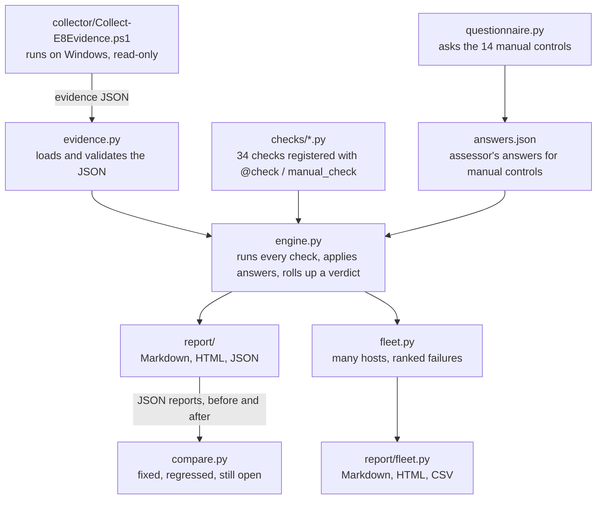

# How e8checker works

A plain-English walkthrough of the code, the reasoning behind it and the questions an interviewer is
likely to ask. Read it alongside `e8checker/engine.py` and one checks module (start with
`e8checker/checks/app_control.py`).

## The 30-second version

> e8checker checks a Windows machine against the ASD Essential Eight at Maturity Level One. A
> read-only PowerShell script collects the evidence (patch history, AppLocker, Office macro policy,
> local admins and so on) into a JSON file. A Python tool then runs 34 checks against that evidence,
> decides which of the eight strategies reach ML1, and writes a report where every finding has a fix
> and a NIST CSF 2.0 and ISO 27001 reference. It can also summarise a whole fleet and tell you which
> fix would help the most machines, and compare two reports to show what remediation actually fixed.
> With `--level 2` it also reports Maturity Level Two readiness for the parts of ML2 an endpoint can show.

## The pieces



| File | Job | Why it is separate |
| --- | --- | --- |
| `collector/Collect-E8Evidence.ps1` | Reads registry, services, AppLocker, Defender, BitLocker and writes one JSON file | Runs on locked-down machines with no Python; changes nothing |
| `e8checker/evidence.py` | Loads the JSON, checks `schema_version`, gives safe `get("a.b.c")` lookups | Evidence is untrusted input; a missing field must not crash a check |
| `e8checker/checks/` | One module per strategy, each check a small function returning `(Status, detail)` | Easy to read, test and extend one control at a time |
| `e8checker/checks/base.py` | The `@check` decorator and registry | Title, severity, fix and framework mappings live next to the logic, so reports never drift |
| `e8checker/engine.py` | Runs all checks, applies manual answers, works out each strategy's verdict | The only place the "is this ML1?" rule lives |
| `e8checker/fleet.py` | Assesses a folder of evidence files and ranks the most common failures | Answers fleet-level questions without changing single-host logic |
| `e8checker/checks/level2.py` | Opt-in ML2 checks: Defender ASR rules, PowerShell logging, process creation auditing, LAPS | Kept apart so Level Two can never change the ML1 verdict |
| `e8checker/compare.py` | Diffs two JSON reports for the same host | Works on saved reports, so it still works after the evidence or the rules change |
| `e8checker/questionnaire.py` | Asks each manual control, validates the answer, records evidence | A typo in a hand-written answers file is silently ignored; a guided prompt cannot make that mistake |
| `e8checker/report/` | Turns results into Markdown, HTML, JSON and CSV | Output format is independent of assessment logic |

## Following one check end to end (AC-01, application control)

1. **Collect.** The collector calls `Get-AppLockerPolicy -Effective -Xml`, counts the rules in each
   collection (Exe, Script, Msi, Dll) and records the enforcement mode. It also records whether the
   Application Identity service (`AppIDSvc`) is running and whether a WDAC policy is enforced.
2. **Load.** `Evidence.from_file()` reads the JSON (as `utf-8-sig`, because Windows PowerShell 5.1
   writes a byte-order mark) and rejects files with an unknown `schema_version`.
3. **Check.** `app_control_core()` in `checks/app_control.py`:
   - passes straight away if WDAC is enforced;
   - otherwise fails if Exe, Script or Msi is not in `Enabled` mode or has no rules;
   - fails separately on `AuditOnly`, because audit mode logs but does not block;
   - fails if the rules are enforced but `AppIDSvc` is not running, because then they are never applied.
4. **Wrap.** `CheckSpec.run()` turns the `(Status, detail)` pair into a `Result` with the title,
   severity, remediation and mappings (NIST `PR.PS-05`, ISO `8.19` and `8.7`). If the function
   throws, the result becomes `ERROR` instead of crashing the whole run.
5. **Roll up.** In `engine.py`, the Application control strategy reaches ML1 only if neither AC-01
   nor AC-02 is FAIL, ERROR or MANUAL.
6. **Report.** The renderer sorts failures by severity and prints the fix.

## How the verdict is decided

Each check ends in one of five statuses (`models.py`):

| Status | Meaning | Blocks ML1? |
| --- | --- | --- |
| PASS | Evidence shows the control is in place | No |
| N/A | Control does not apply (for example Office macro checks with no Office installed) | No |
| FAIL | Evidence shows the control is missing | Yes |
| ERROR | Evidence was missing or unreadable | Yes |
| MANUAL | Cannot be seen from the endpoint; needs an assessor's answer | Yes |

A strategy reaches **Maturity Level One** only when none of its checks block. If something
failed, the verdict is **Maturity Level Zero**. If nothing failed but manual answers are missing,
the verdict is **Unconfirmed**, because the tool refuses to guess.

Manual controls (MFA, backups, privileged-access processes) are resolved by an answers file:

```json
{"MF-01": {"answer": "yes", "note": "Entra Conditional Access policy 'Require MFA - all users'"}}
```

"yes" turns the control into PASS and keeps the note as evidence; "no" turns it into FAIL with the fix.

## Why it is built this way

- **Collector and analyser are split.** Production machines often cannot have Python installed, and
  an assessor wants to re-run the analysis (with new answers or a newer rule set) without touching
  the machine again. JSON in the middle makes that possible and gives an audit trail.
- **Read-only by design.** An assessment tool that changes settings is a change-management problem
  and a risk. The collector only reads.
- **No false passes.** Missing evidence is ERROR and organisational controls are MANUAL. Reporting a
  pass you cannot see is worse than reporting nothing, especially when the report goes to a CIO.
- **Group Policy hives only, for Office and browsers.** ML1 says users must not be able to change
  these settings. A value in the policy hive proves that; the same value in the user's own settings
  does not.
- **The logged-on user's hive.** The collector usually runs elevated as an admin, but the settings
  that matter are the end user's. It reads `HKEY_USERS\<SID>` for the interactive user instead of
  the admin's `HKCU`.
- **Evidence is untrusted.** A compromised machine could put `<script>` in a software name. Every
  value is HTML-escaped, Markdown pipes are escaped, and CSV cells starting with `= + - @` are
  prefixed so Excel cannot run them as formulas. Each has a test.
- **One source of truth for metadata.** Title, severity, fix and mappings are declared in the
  decorator, and `docs/control-mapping.md` is generated from them; CI fails if the doc is stale.
- **Edition-aware lifecycle.** Windows 11 24H2 Home/Pro and Enterprise reach end of servicing a year
  apart, and Windows Server 2025 shares a build number with Windows 11 24H2. The lookup uses edition
  and family, not just build number.
- **Compare works on reports, not evidence.** A saved JSON report records what the rules said at
  the time. Comparing reports means a before/after view still makes sense after e8checker gains new
  checks: they show up as "new checks" instead of looking like regressions.
- **The questionnaire never overwrites by accident.** It refuses to replace an existing answers file
  unless told `--update` (keep and revise) or `--force` (start again), and if input stops early it
  keeps every answer already given.
- **Level Two is readiness, not a verdict.** ML2 includes central logging, event analysis and access
  reviews that a single endpoint cannot show. Claiming "ML2" from registry values would overstate the
  position, so Level Two results sit in their own section and the ML1 verdict is computed without them.
- **Levels checked against the source.** LSA protection and Credential Guard are often called ML2
  items, but ASD places them at Maturity Level Three. They are collected and labelled ML3 (not scored).
- **ASR Audit mode is not enough.** An attack surface reduction rule in Audit or Warn mode records
  or prompts but does not block, so only Block passes, the same reasoning as AppLocker audit mode.
- **Fleet failures exclude manual controls.** "Not answered yet" is not the same as "broken", so the
  ranked fix list only counts FAIL and ERROR.

## What it does not do (say this before you are asked)

- The verdict is Maturity Level One only. Level Two is reported as readiness, and ML3 is not
  assessed, because both need evidence one endpoint cannot give (central logging and analysis).
- It assesses evidence from one machine at a time; the fleet command aggregates many files but does
  not collect them. At scale you would push the collector with Intune, SCCM or a GPO.
- The NIST and ISO mappings are the author's indicative mappings, not an official crosswalk.
- The lifecycle and unsupported-software tables need maintenance.
- It supports an assessment; it does not replace one done under ASD's *Essential Eight Assessment
  Process Guide*.

## Likely interview questions

**What is the Essential Eight and why ML1?**
Eight mitigation strategies from the Australian Signals Directorate: application control, patch
applications, Office macro settings, user application hardening, restrict admin privileges, patch
operating systems, MFA and regular backups. Each has maturity levels one to three. ML1 is the
baseline most organisations target first, and it is the level where a single endpoint gives you
enough evidence for most controls.

**Why does audit-mode AppLocker fail?**
Audit mode logs what would have been blocked but still lets it run. The control is "prevent
execution", so logging alone does not meet it. Audit mode is a deployment step, not the end state.

**How do you avoid false positives and false negatives?**
False passes are avoided by never defaulting to PASS: missing data is ERROR, unknown OS builds are
MANUAL. False failures are reduced with N/A (no Office means macro checks do not apply), by
accepting WDAC as well as AppLocker, by accepting third-party antivirus, and by accepting
gateway ad filtering instead of a browser extension.

**Why read the policy hive instead of the normal settings?**
Because ML1 requires that users cannot change the setting. Only a policy value proves that.

**What would you do with a report that says 0 of 8?**
Use the fleet view to find the fix that helps the most machines, start with high-severity items
that are cheap to deploy centrally (macro policy and IE removal through Group Policy, patching
cadence), and plan application control in audit mode first so nothing breaks, then enforce.

**How does this map to NIST CSF 2.0 and ISO 27001?**
Each check carries references, for example application control maps to `PR.PS-05` (unauthorised
software is prevented) and ISO 27001 Annex A `8.19` (installation of software on operational
systems). That lets one report serve the security team and the compliance team.

**How would you scale this to 2,000 machines?**
Deploy the collector as an Intune remediation script or scheduled task, write the JSON to a
restricted share, and run `e8checker fleet` over the folder. The CSV output goes into Excel or
Power BI for trend tracking. The next step would be a Microsoft Graph collector for Intune-managed
devices.

**How would you show that remediation is working?**
Save a JSON report before the change window and another after, then run `e8checker compare`. It
shows the ML1 count moving, which controls were fixed and, more importantly, anything that
regressed. With `--fail-on-regression` the same command can run on a schedule and alert when a
Group Policy change quietly undoes a control.

**Why doesn't the tool say a machine is at Maturity Level Two?**
Because ML2 is more than endpoint settings: it needs events centrally logged and analysed, privileged
access revalidated every 12 months, and administration through jump servers. The tool checks what the
endpoint can show (ASR rules, PowerShell logging, LAPS), asks the rest as manual controls, and calls
the result "readiness". Overclaiming maturity is worse than reporting less.

**How do you handle controls a script cannot see, like MFA?**
They are marked MANUAL and block ML1 until someone answers them. `e8checker questionnaire` asks
each one and records an evidence note (for example the Conditional Access policy name), so the
report shows not just "yes" but why the assessor believed it.

**What security risks does the tool itself have, and how did you handle them?**
The evidence file is untrusted, so output is escaped (HTML, Markdown and CSV formula injection).
The collector is read-only and makes no network calls. Evidence files contain usernames and
software lists, so `.gitignore` keeps real ones out of the repository and `SECURITY.md` explains it.

**How did you test it?**
211 pytest cases with three synthetic hosts (weak, partial, hardened). Every automated check
must pass on the hardened host, fail with a fix on the weak host, and not crash on empty evidence.
Edge cases cover patch-window boundaries, audit mode, edition-specific lifecycle dates and
injection attempts. CI runs the suite on Python 3.10 to 3.13 and runs the collector on a real
Windows runner.

**What did you use AI for?**
Answer honestly. The README states the project was built with AI pair-programming help. Be ready
to explain what you reviewed, what you changed, and walk through any file on request.

## Exercises to make it yours

1. Run the collector on your own laptop and read the JSON it writes. Which checks fail, and why?
2. Add a check. For example, a supporting check that flags Windows Script Host being enabled:
   add the registry read to the collector, write the check function, add a test, and
   regenerate `docs/control-mapping.md` with `python tools/generate_mapping_doc.py`.
3. Change `MAX_LOCAL_ADMINS` in `checks/admin.py` and watch which tests fail. That shows you which
   behaviour the tests protect.
4. Write an answers file for a pretend organisation and see the verdict move from Unconfirmed to ML1.
